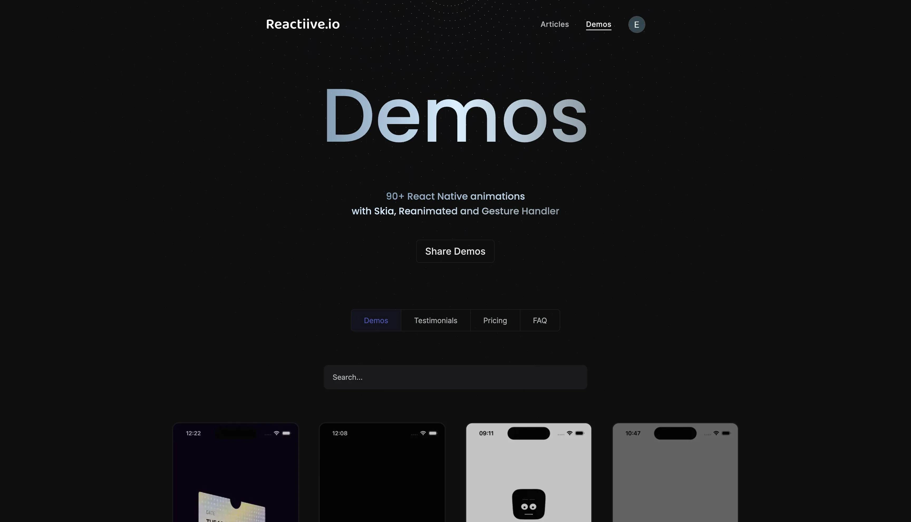

<Title date="2025-01-17" slug="building-demos">
  How did I build Demos?
</Title>

After announcing the transition [from Patreon to Demos](/articles/leaving-patreon), many of you asked about the technical decisions behind [Demos](/demos). As someone who's passionate about both creating animations and building robust platforms, I wanted to share the journey of bringing this project to life.

In this article, I'll walk you through the main technologies and tools that power Demos, explaining why I chose them and how they contribute to the overall platform. From using Expo for web development to handling payments with LemonSqueezy, each choice reflects a balance between functionality, developer experience, and long-term sustainability.

_Note: this article is not sponsored by any of the tools I'm going to talk about. I'm just sharing my experience and the choices I made._

## Expo as the Web Framework

Until a few months ago, I had never used Expo for the Web, despite always being fascinated by its potential.

For those with a native app looking to expand to the Web, Expo is a natural and powerful choice. However, choosing Expo (today) for a web-only project might seem bold.

My decision was primarily philosophical—I loved the idea of showcasing Expo animations on a website built with Expo itself 😅

I strongly believe that React Native and Expo represent the future of cross-platform development. With a long-term vision for Reactiive.io, it felt like the perfect fit.

To this day, every time I reopen the website, that animated Skia Spiral reminds me that I made the right choice.

Also, [Expo Router API Routes are wild](https://docs.expo.dev/router/reference/api-routes/)

### What about Reactiive.io?

I usually talk about Demos, like it was a whole different website. However, as you can see, Demos is built within Reactive.io as [/demos](/demos).

Initially Reactiive.io was built with Next.js and [I decided to rewrite it with Expo](https://x.com/reactiive_/status/1847212317445947547) in October 2024 having the idea of launching Demos on top of it.

[Evan Bacon's blog source code](https://github.com/EvanBacon/evanbacon.dev) was an amazing resource to get started redesigning the website.

## ⚡️ Supabase as a Database

Choosing Supabase feels like a no-brainer today. Having previously used it for [Reanimate.dev](https://reanimate.dev), I couldn't imagine a better database solution for this project.

While I initially considered Prisma as the ORM, the buzz around Drizzle ORM caught my attention. After giving it a try, I was immediately impressed by its capabilities.

I highly recommend following [Raphaël Moreau](https://x.com/rphlmr) if you're interested in Drizzle ORM. He is constantly posting valuable content.

## 💵 LemonSqueezy for Payments

I live in Italy and taxes in the EU can be a bit of a headache. I'm not here to complain about how high they are—especially when I can still enjoy a great pizza—but figuring out how to deal with them when selling globally can be incredibly time-consuming.

LemonSqueezy is a Merchant of Record (MoR) and it makes this process so much easier. Plus, it has a very nice UI for the payment form 🤓

## 😌 Hosting on Vercel but...

Demos is hosted on Vercel. Yes, I know—there are cheaper solutions. But honestly, the quality of their service, their UI, and the overall user experience make it absolutely worth it for me.

Their website is also filled with amazing animations. Maybe one day I'll add one to Demos too! 👀

So yes, Vercel is great but Expo recently announced EAS Hosting and I'm quite excited about it. Most likely, I'll move Demos to EAS Hosting in the future.

## 🧑‍💻 Hosting code on GitHub

I probably shouldn't even explain this choice. But it's not such an obvious choice. On Patreon, I was forced for years to share animation code zipped in a file.

For Demos, all animations are published on a GitHub organization. I decided to use an organization since I can easily invite collaborators and manage repos without API request limits, automating invites and removals (in case of expired subscriptions).

## 📈 Amplitude for Analytics

I must admit that I don't track analytics data very intelligently (I could make an effort to at least understand which demos you like the most).

But Amplitude has an extremely generous free plan and is very easy to integrate. I would recommend it to anyone who wants to track analytics data for both personal and commercial projects.

## Conclusion

While this overview covers the main technical decisions behind Demos, there's still much more to explore.

For instance, _was it worth to build a custom platform, or should I have just used Patreon?_
