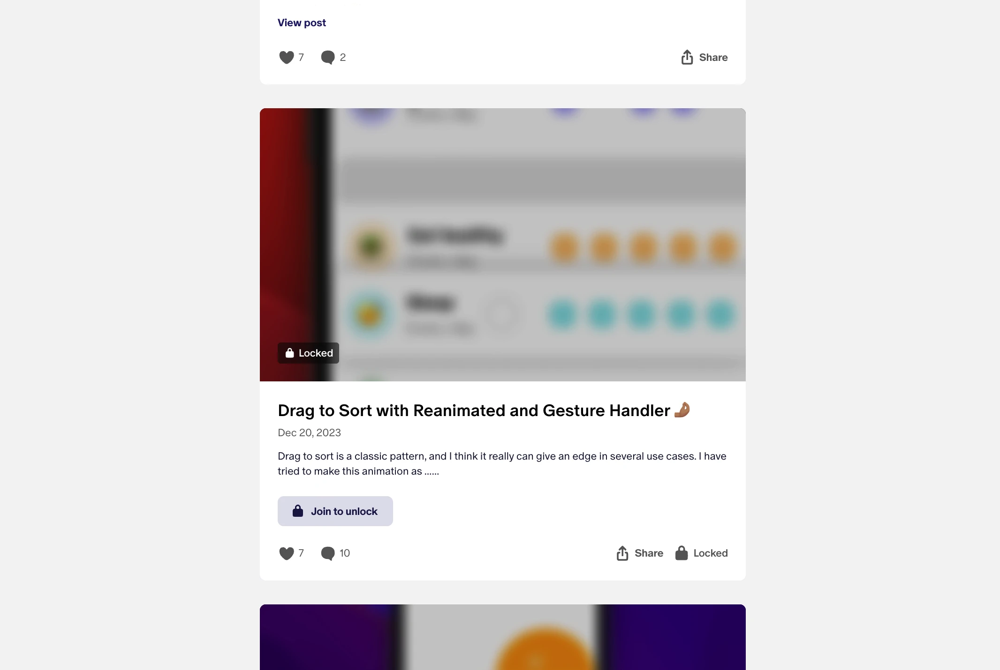
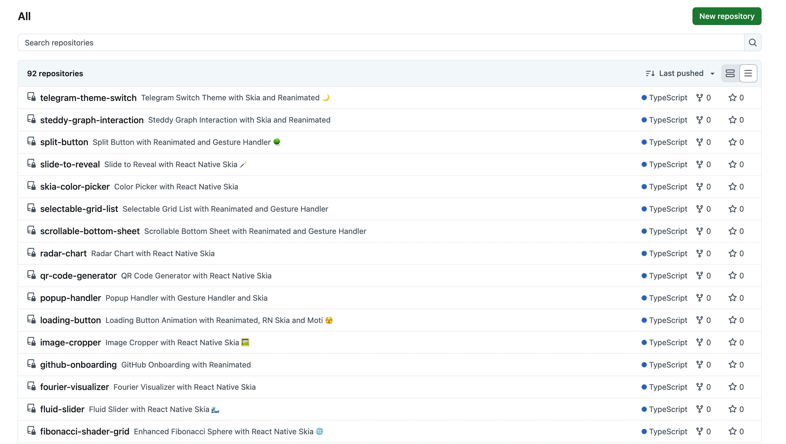

<Title date="2024-11-21" slug="leaving-patreon">
  Leaving Patreon - Moving to Demos
</Title>

I've always loved sharing content, though I never considered myself a content creator.
I started my journey on YouTube 3 years ago and it was all about sharing some small things about Reanimated.

Working full-time as a Software Engineer, after a while, I realized that recording videos late at night and during weekends was not sustainable in the long run.

So I started thinking about Patreon.

It took me two weeks to realize that posting content on Patreon isn't sustainable either 🤣

However, I gained much more from my Patrons than they did from me. With some of them, I worked as a consultant and I had long-term collaborations. From others, I learned a lot of new things about animations and design.

## Why leave Patreon?

Patreon has been a great platform for me but after 2 years, I've encountered some limitations:

1. Old posts lose value very quickly
2. It's not suitable for code-based content
3. I don't have a lot of control over the perks

To overcome these limitations, I started thinking about building my own platform.

## So, what's next?

In early December, I'll launch **Demos**, which will be an additional section at Reactiive.io (this website).

How will it solve those limitations?

1. **Solving "Old posts lose value very quickly"**  This is the most annoying thing on Patreon. It's almost impossible to find an old post. I made 90+ React Native animations in 2 years but searching through them is painful.   For instance, I worked on a Drag & Sort animation in December 2023. If you saw it and want to find it, you have to scroll through 40+ posts. If you're not aware of it, you'll never find it.  Additionally, you can't see the animation previews if you're not a Patreon supporter (which is ridiculous).   On the new platform, **I will make my best to make it easy to find my old/new content** for any user.

 

2. **Solving "It's not suitable for code-based content"**  I'll be able to include some code snippets and to better format the brief explanations.  Finally, I won't have to zip my source codes. The code will be hosted in a Private GitHub organization (as it works currently on [Reanimate.dev](https://reanimate.dev)).   

 

3. **Solving "More control over the perks"**  With Patreon you can differentiate the perks based on the monthly plan they are subscribed to.  However, there's no way to reward my supporters based on the time they have been supporting me, which is something much more valuable.  Therefore, **Demos** will have two main plans:
   - Monthly Supporter: _8 USD/month_
   - Annual Supporter: _60 USD/year (5 USD/month)_

   The Monthly Supporter will continue to have access to all the posts, exactly as it currently works on Patreon.

   The Annual Supporter will get everything the Monthly Supporter has at a discounted price. In addition to that, it will get access to the Demos App source code which will be constantly updated with the new demos I'll create.

### ✨ Demos App (Annual Supporter-only) ✨

The Demos App will host all the demos I'll create (and the ones I've created in the past) and it will be maintained on a weekly basis. The app will be executable via Expo Go.

I shared a sneak peek a few months ago on Twitter. Yes, it took more than I was expecting:

<Embed url="https://twitter.com/reactiive_/status/1837499524241412342" />

While I attempted a similar project on Patreon last year with the 2023 demos, I found myself less motivated to maintain it. The issue was that both new and long-time Patreon supporters had equal access to the fully maintained app:

<Embed url="https://twitter.com/reactiive_/status/1742519413641760804" />

To address this and provide more value to committed supporters, I've decided to make the Demos App an exclusive benefit for Annual Supporters.

This approach allows me to invest more time and effort into creating a high-quality and evolving product for those who want to support my work in the long term.

## How will the migration work?

I've created a dedicated article on how I imagined the migration for the active Patrons: [Migration: from Patreon to Demos](/articles/patreon-migration).

## What will happen to the current [Patreon account](https://www.patreon.com/reactiive)?

I'll keep the current Patreon account with all the old posts and perks without updating them, but I won't publish any new posts on Patreon.

## When and what to expect for the launch?

I'll launch the new platform in the first week of December.

Currently, I'm actively working on getting Demos ready for the launch.

The platform will have some initial missing features such as Likes/Comments and Chat that I'll integrate around Q1 and Q2 2025.

Thanks a lot for reading this far, hope you'll enjoy Demos!

### Questions or feedback?

You can always DM me directly on [Patreon](https://www.patreon.com/reactiive_) or [X](https://x.com/reactiive_).
