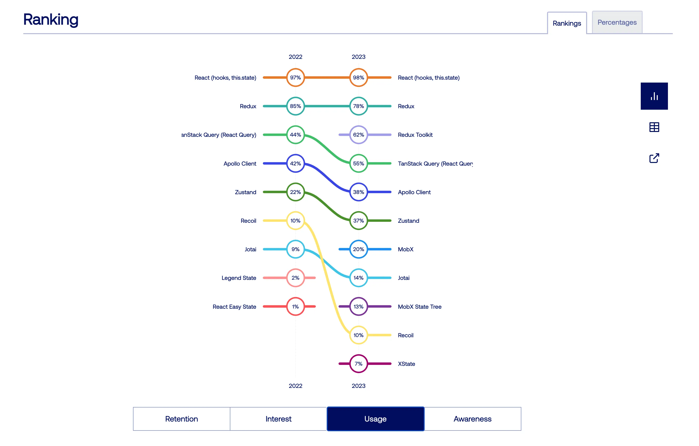
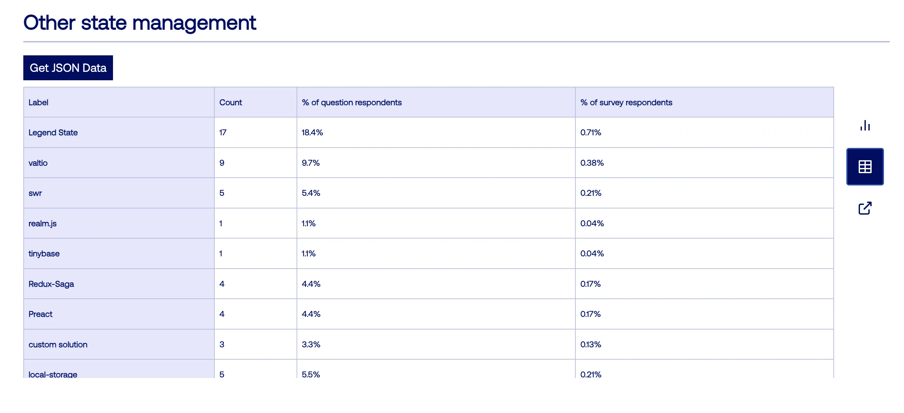
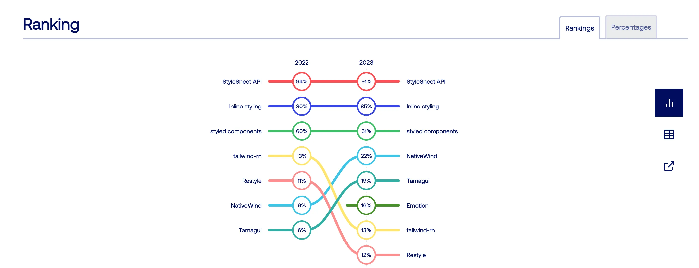
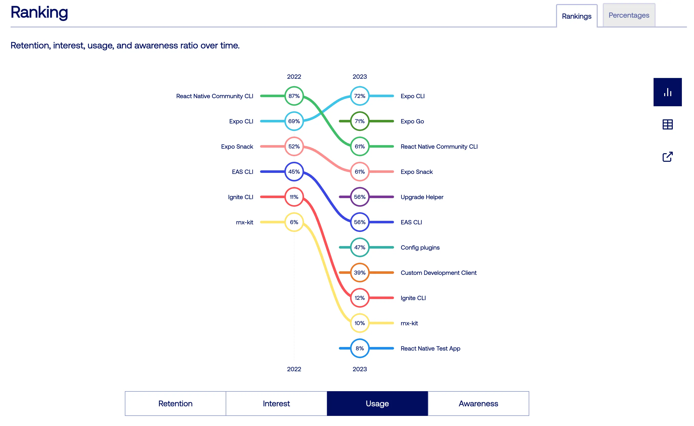
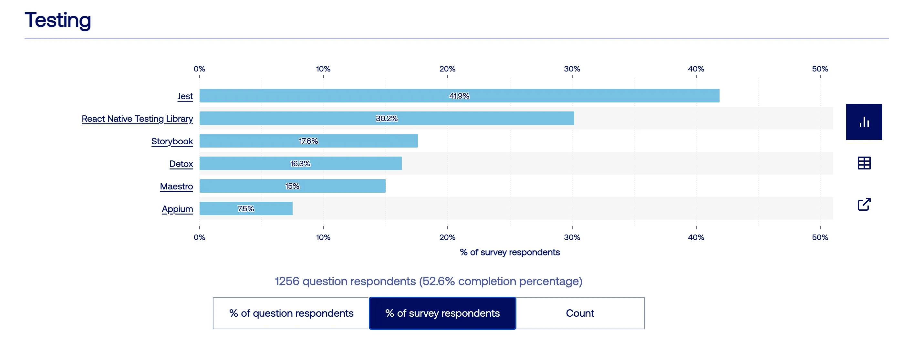
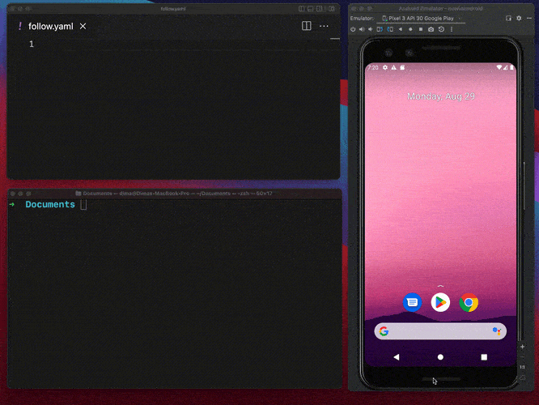

<Title date="2024-03-08" slug="the-hidden-gems-of-react-native">
  The Hidden Gems of React Native
</Title>

Recently, I read _"Zero to One: Notes on Startups, or How to Build the Future"_ written by **Peter Thiel**. At the beginning of the book, **Peter Thiel** starts with a question: _"What important truth do very few people agree with you on?"_

The problem he raises is that most people think that the future is going to be a slightly modified version of the present. Asking yourself this question is a good way to challenge this assumption and to think about what the future could be and how to build a very successful startup.

Unfortunately, I'm very far from having the answer to this question in the context of startups, but I think I have some good answers in the context of **React Native**.

And that's what this article is all about.

### State of React Native

To be honest, I was just trying to craft a catchy introduction. I don't have a secret truth about React Native that no one knows about.

What I did was simply to look at the [State of React Native (2023)](https://results.stateofreactnative.com/) and try to find some hidden gems that, apparently, are not so popular but can be very useful in some specific scenarios.

State of React Native is a survey made by Software Mansion and created by [Bartłomiej Bukowski](https://twitter.com/bbarthec) that is conducted every year to understand the current state of React Native. It's a great way to understand what the community is using and what the most popular libraries and tools are (and also the hidden gems).

### TLDR;

I know that you're busy and you don't have time to read the whole article. So here is a list of the hidden gems of React Native that I'm going to talk about:

- Jotai: An atomic approach to State management
- Valtio: Proxy state made simple
- Shopify Restyle: Build a consistent, themed UI in minutes
- Ignite (Infinite Red): The battle-tested React Native boilerplate
- Maestro: The simplest and most effective mobile UI testing framework

P.S: That's not a ranking.

### About this article

None of the libraries and tools that I'm going to talk about are sponsored. I'm just sharing my personal experience and my personal opinion about them.

## Jotai: An atomic approach to State Management

When filtering by the "State Management" category in the State of React Native, the usage percentage of Jotai is 14%. It's not a bad number, but it's not as popular as Redux, Redux Toolkit, or Zustand.



Jotai, created by [Daishi Kato](https://twitter.com/dai_shi), is probably one of the most interesting libraries in the React ecosystem.

Just to add a bit of context, Daishi is a React library author. He maintains three state management libraries: Zustand, Jotai, Valtio, and the React Server Components framework, Waku (sponsored by [Vercel](https://vercel.com/)).

When your mind tricks you into thinking that you're a great developer, just remember that there are people like Daishi 😅.

### Why Jotai is so great?

I use Jotai in almost all of my projects, and I think it really shines when you need to manage complex state in a very simple way. The beauty of it is that it makes the idea of "Recoil atoms" lightweight and easy to use.

The main concept of Jotai is the **atom**. An atom is a state that can be read and written. You can create an atom using the _atom_ function, and then you can use the _useAtom_ hook to read and write the state.

P.S: For those aiming for a touch of cultural flair, "Jotai" translates to "State" in Japanese.

```tsx
import { atom, useAtom } from 'jotai';

const countAtom = atom(0);

function Counter() {
  const [count, setCount] = useAtom(countAtom);
  return (
    <View>
      <Text>{count}</Text>
      <TouchableOpacity onPress={() => setCount((c) => c + 1)}>
        increment
      </TouchableOpacity>
    </View>
  );
}
```

The _useAtom_ hook returns the current value of the atom and a function to update it. When the atom is updated, the component is re-rendered.

### Atoms With Storage

I don't want to make this article too technical, but I think it's worth making an exception for the _atomWithStorage_ function.

Managing state persistence with React Native can be very tricky, especially when you need to manage the state of the app when it's closed and reopened. Jotai has a built-in function to handle this scenario.

What I really love is using this feature in combination with [react-native-mmkv](https://github.com/mrousavy/react-native-mmkv) (which is also a bonus gem) to persist the state of the app in a very efficient way.

To do that, I define a custom storage using _react-native-mmkv_, and then I create a helper function called _createJotaiStorage_ that returns a storage object, which can be used with _atomWithStorage_.

```tsx
import { MMKV } from 'react-native-mmkv';

const storage = new MMKV({
  id: 'define.an.id',
});

const createJotaiStorage = <T>() =>
  createJSONStorage<T>(() => ({
    getItem: key => {
      return storage.getString(key) ?? null;
    },
    setItem: (key, value) => storage.set(key, value),
    removeItem: key => storage.delete(key),
  }));
```

Then I can use the custom _atomWithStorage_ function to create an atom that will be persisted in the storage.

```tsx
import {
  createJSONStorage,
  atomWithStorage as jotaiAtomWithStorage,
} from 'jotai/utils';

// Get On Init will ensure that the atom will be initialized with the value from the storage
// and it must be used in combination with React Suspense
export const defaultStorageOptions = {
  getOnInit: true,
};

export const atomWithStorage = <T>(key: string, initialValue: T) => {
  const storage = createJotaiStorage<T>();

  return jotaiAtomWithStorage<T>(
    key,
    initialValue,
    storage,
    defaultStorageOptions
  );
};
```

Learn more: [Jotai Documentation](https://jotai.org/)

## Valtio: Proxy state made simple

Valtio is another state management library made by Daishi Kato. According to the State of React Native survey, Valtio appears in the "Other State Management" section with 9 votes, representing 9.7% of question respondents and 0.38% of survey respondents.



Since I already mentioned that I use Jotai in almost all of my projects, it's hard to believe that I also use Valtio. However, the truth is that I discovered Valtio recently, and the best definition of it is _"pure magic"_.

Here's an example of how to use Valtio:

```tsx
import { proxy, useSnapshot } from 'valtio';

const state = proxy({ count: 0, text: 'hello' });

function Counter() {
  const snapshot = useSnapshot(state);
  return (
    <View>
      <Text>{snapshot.count}</Text>
      <TouchableOpacity onPress={() => state.count++}>
        increment
      </TouchableOpacity>
    </View>
  );
}
```

The _proxy_ function creates a proxy object that can be used to store the state. The _useSnapshot_ hook returns the current value of the proxy object, and it will re-render the component only when the used properties are updated. This means that in the example above, the "text" property will not trigger a re-render if it's updated from a different component.

**HOW IS THAT POSSIBLE?** 🤯

I truly recommend the following articles to understand the magic behind Valtio:

- [How Valtio Proxy State Works (Vanilla Part)](https://blog.axlight.com/posts/how-valtio-proxy-state-works-vanilla-part/)
- [How Valtio Proxy State Works (React Part)](https://blog.axlight.com/posts/how-valtio-proxy-state-works-react-part/)

Learn more: [Valtio Documentation](https://valtio.pmnd.rs/)

## Shopify Restyle: Build a consistent, themed UI in minutes

The Restyle library offers a type-enforced system for constructing UI components in React Native with TypeScript. It's designed specifically for building UI libraries, with themability as its core focus.

In the State of React Native, Restyle boasts a usage percentage of 12%.



I discovered this package a few years ago while following the [React Native Fashion tutorial series by William Candillon](https://www.youtube.com/watch?v=MqRnpUC4czs&list=PLkOyNuxGl9jyhndcnbFcgNM81fZak7Rbw) (an additional bonus hidden gem).

The beauty of Restyle lies in its flexibility: **you define the rules**, the theme, the components, the variants, and then you can use them to build your UI.

```tsx
import { createTheme } from '@shopify/restyle';

const palette = {
  purpleLight: '#8C6FF7',
  purplePrimary: '#5A31F4',
  purpleDark: '#3F22AB',

  greenLight: '#56DCBA',
  greenPrimary: '#0ECD9D',
  greenDark: '#0A906E',

  black: '#0B0B0B',
  white: '#F0F2F3',
};

const theme = createTheme({
  colors: {
    mainBackground: palette.white,
    cardPrimaryBackground: palette.purplePrimary,
  },
  spacing: {
    s: 8,
    m: 16,
    l: 24,
    xl: 40,
  },
  textVariants: {
    header: {
      fontWeight: 'bold',
      fontSize: 34,
    },
    body: {
      fontSize: 16,
      lineHeight: 24,
    },
    defaults: {
      // We can define a default text variant here.
    },
  },
});

export type Theme = typeof theme;
export default theme;
```

Learn more: [Restyle Documentation](https://shopify.github.io/restyle/)

## Ignite (Infinite Red): The battle-tested React Native boilerplate

Ignite is a React Native boilerplate created by [Infinite Red](https://infinite.red/). It's a great way to start a new project with a lot of features already set up.

When I started working for my first company, I was introduced to Ignite by one of the senior developers. At the time, he suggested to initialize the project using the Redux Saga boilerplate (there really was an Ignite Redux Saga boilerplate at the time or my memory is failing me? 🤔
).

The developer was really good from a technical perspective, but unfortunately, he was (just a bit) arrogant and I didn't trust him. So I started the project from scratch with the default React Native CLI.

Fortunately, the beauty of life is that you are always in time to fix your mistakes. I rediscovered the Ignite CLI a few years later, and I've been using it a lot as my starting point for new projects.

By checking the State of React Native, Ignite appears in the "React Native Tools" section with 12% usage. To be fair, they have [16k+ stars on GitHub and 1.5k+ forks](https://github.com/infinitered/ignite), so I think that compared to the other hidden gems, Ignite is not so hidden 😅.



What I really love about Ignite is that all the best practices are already set up for you, and their stack is based on conservative choices that are battle-tested and proven to work.

Honestly, I love experimenting with things that really shouldn't be used in production, but when it comes to starting a new project, I think it's better to start with a solid foundation. Ignite is the perfect starting point for that.

Learn more: [Getting Started with Ignite](https://youtu.be/KOSvDlFyg20) & [Ignite GitHub](https://github.com/infinitered/ignite)

## Maestro: The simplest and most effective mobile UI testing framework

Maestro is a mobile UI testing framework that allows you to write end-to-end tests in a simple and effective way.

It was selected by 15% of the respondents in the State of React Native survey.



I discovered Maestro thanks to this outstanding App.js Conf talk by [Henry Moulton](https://twitter.com/henrymoulton):
[React Native end-to-end testing with Maestro](https://youtu.be/uoCzBdFCoqc).

Testing frameworks are usually complex and require a lot of setup. The philosophy behind Maestro is to make the testing process as simple as possible. Testing shouldn't be harder than writing the app itself.

The best way to visualize the power of Maestro is to see it in action. Here's an example taken from the official [documentation](https://maestro.mobile.dev/).



The magical part is that the end-to-end tests are basically independent from the app. You can even write the tests before the app is built, and then you can use them to drive the development of the app.

Learn more: [Maestro Documentation](https://maestro.mobile.dev/)

## Conclusion

I hope you found this article useful and that you discovered some new hidden gems of React Native. I'm sure there are many other hidden gems that I didn't mention in this article.

My goal was to share my personal experience and opinion about these libraries and tools. I hope you found it helpful and that you will consider using them in your next projects.
